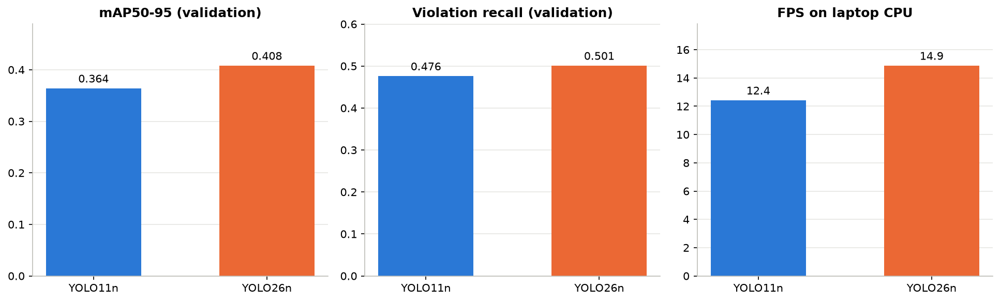
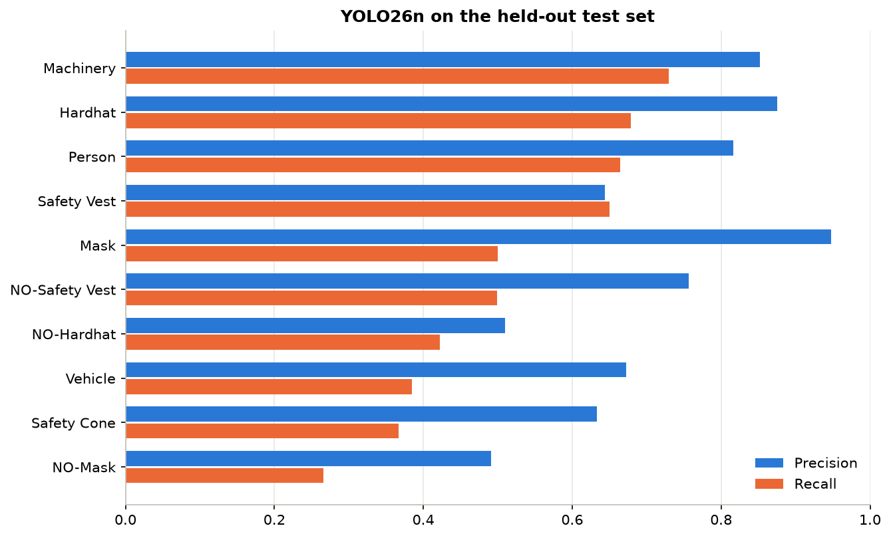
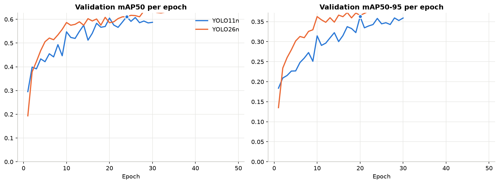
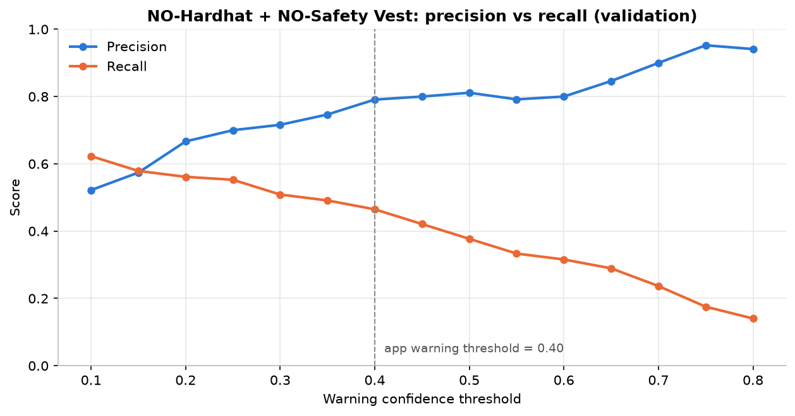
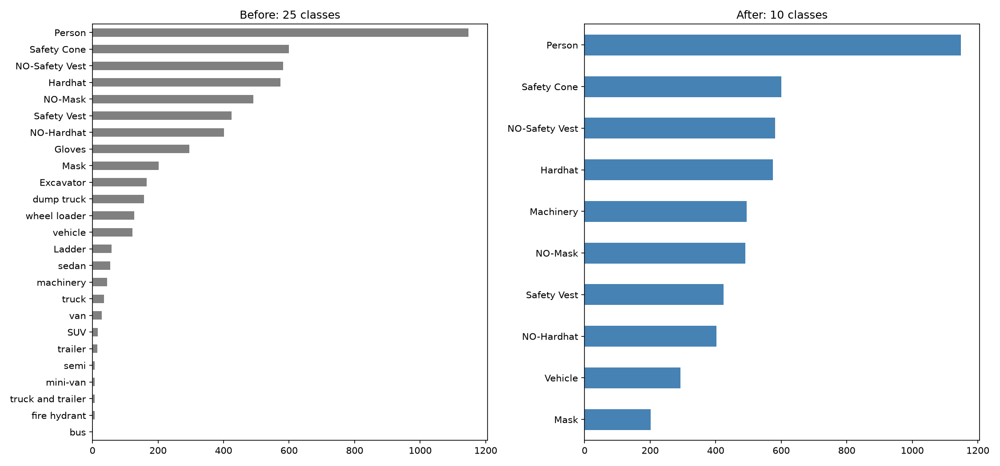
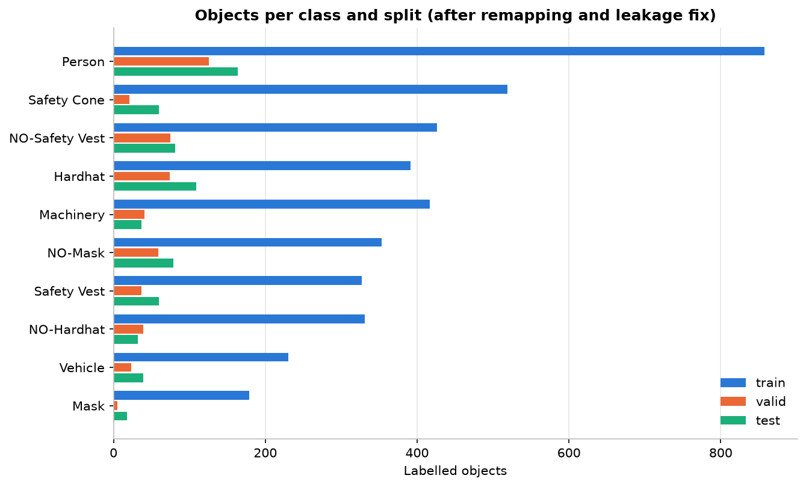
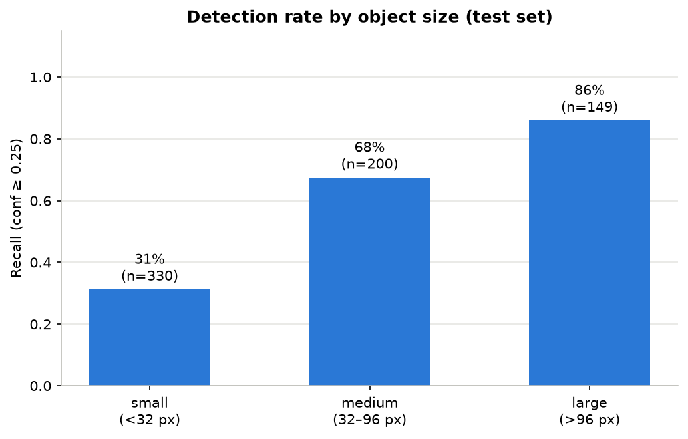

# 🦺 Construction Site PPE Safety Monitor

Real-time detection of workers, personal protective equipment (PPE) and safety violations on construction sites, using **YOLO26n** and **OpenCV**, with an interactive **Streamlit** web app.

The system finds hard hats, safety vests, masks, workers, machinery, vehicles and safety cones, and raises a warning when a worker is **missing a hard hat or safety vest**. It runs at **~15 FPS end-to-end on a laptop CPU**, so no GPU is required.


<!-- Live demo: [Try it on Hugging Face Spaces](https://huggingface.co/spaces/<your-username>/ppe-safety-monitor) -->

---

## Contents

1. [Highlights](#highlights)
2. [Quick start: use the trained model](#quick-start-use-the-trained-model)
3. [Results](#results)
4. [Dataset](#dataset)
5. [Method](#method)
6. [Reproduce everything from scratch](#reproduce-everything-from-scratch)
7. [Project structure](#project-structure)
8. [Limitations and future work](#limitations-and-future-work)
9. [Credits and license](#credits-and-license)

---

## Highlights

- **10-class PPE detector** fine-tuned from YOLO26n (2.4 M parameters) on 717 construction-site images.
- **Data redesign:** the source dataset had 25 classes, some with a single example. The classes were merged into 10 based on object counts, which reduced the class imbalance from **1148× to 5.7×**.
- **Leakage fix:** frames from the same videos were spread across train, validation and test. The images were grouped by source video, and **52 leaked images** were moved into train, so the test set contains only images the model has never seen.
- **Model selection:** YOLO11n and YOLO26n were compared on the same data and CPU. YOLO26n was more accurate (mAP50-95 **0.408 vs 0.364**) and faster.
- **Two apps:** an OpenCV app for video and webcam that writes a violation log, and a Streamlit web app with adjustable thresholds and a per-video safety summary.
- **Threshold design:** boxes are *shown* above confidence 0.25, but a *warning* is raised only above 0.40. This cuts false alarms without hiding detections.

---

## Quick start: use the trained model

You need **Python 3.10–3.12** and **Git**. A GPU is not needed.

### 1. Clone the repository

```bash
git clone https://github.com/<your-username>/ppe-safety.git
cd ppe-safety
```

### 2. Create a virtual environment and install the requirements

**Windows (PowerShell)**

```powershell
python -m venv venv
venv\Scripts\activate
pip install --timeout 1000 -r requirements.txt
```

**macOS / Linux**

```bash
python3 -m venv venv
source venv/bin/activate
pip install --timeout 1000 -r requirements.txt
```

> PyTorch is about 120 MB. On a slow connection, `--timeout 1000` stops pip from giving up halfway.

Check that the environment is set up correctly:

```bash
python src/check_env.py
```

### 3. Run the web app

```bash
streamlit run app.py
```

Your browser opens at `http://localhost:8501`. Upload an image or a video, and use the sidebar sliders to change the detection and warning thresholds.

### 4. Run the OpenCV app (video, image or webcam)

```bash
python src/detect_video.py --source path/to/video.mp4
python src/detect_video.py --source path/to/image.jpg
python src/detect_video.py --source 0                  # webcam
```

| Option | Default | Meaning |
|---|---|---|
| `--weights` | `models/exp_b_yolo26n.pt` | Trained model to use |
| `--conf` | `0.25` | Draw boxes above this confidence |
| `--alert-conf` | `0.40` | Raise a warning above this confidence |
| `--no-show` | off | Process without opening a window (faster) |

Press **Q** to stop. Outputs are saved in `reports/predictions/run_<date>_<time>/`:

```
output.mp4        annotated video
alerts/           snapshots of frames with violations (at most one every 2 s)
violations.csv    frame, video time, class and confidence of every violation
```

### 5. Use the model in your own Python code

```python
from src.model import load_model, detect, annotate
import cv2

model = load_model()                       # loads models/exp_b_yolo26n.pt
frame = cv2.imread("site.jpg")
result, counts, alerts = detect(model, frame, conf=0.25, alert_conf=0.40)

print(counts)    # {'Person': 4, 'Hardhat': 3, 'NO-Hardhat': 1, ...}
print(alerts)    # [('NO-Hardhat', 0.71)]
cv2.imwrite("out.jpg", annotate(result, counts, alerts))
```

---

## Results

### Model comparison (validation set, 79 images)

| Model | Params | mAP50 | mAP50-95 | Precision | Recall | Violation recall* | CPU FPS** |
|---|---|---|---|---|---|---|---|
| Pretrained YOLO11n (no fine-tuning) | 2.6 M | 0.006 | 0.003 | 0.145 | 0.029 | – | – |
| YOLO11n, fine-tuned | 2.6 M | 0.606 | 0.364 | 0.740 | 0.542 | 0.476 | 13.3 |
| **YOLO26n, fine-tuned (final)** | **2.4 M** | **0.647** | **0.408** | 0.738 | **0.604** | **0.501** | **15.2** |

\* Mean recall of NO-Hardhat and NO-Safety Vest, the two classes that trigger warnings.
\*\* End-to-end speed (read image, resize, infer, post-process) on an Intel Core i7-1165G7 laptop CPU. The model alone takes about 40 ms per image.

The pretrained baseline scores close to zero because the COCO model has no PPE classes. This shows that fine-tuning is essential for the task.



### Final model on the held-out test set (65 images)

| Precision | Recall | mAP50 | mAP50-95 |
|---|---|---|---|
| _fill in_ | _fill in_ | _fill in_ | _fill in_ |

<!-- Values from reports/metrics/exp_b_yolo26n_test.json. The test set was evaluated once, after the model was selected on validation. -->



### Per-class results, YOLO26n (validation)

| Class | Precision | Recall | mAP50 | mAP50-95 |
|---|---|---|---|---|
| Safety Cone | 0.913 | 0.905 | 0.922 | 0.649 |
| Person | 0.772 | 0.690 | 0.788 | 0.554 |
| Hardhat | 0.927 | 0.687 | 0.766 | 0.543 |
| Safety Vest | 0.709 | 0.730 | 0.691 | 0.472 |
| Mask | 0.696 | 0.600 | 0.684 | 0.375 |
| Machinery | 0.693 | 0.659 | 0.682 | 0.514 |
| NO-Safety Vest | 0.846 | 0.514 | 0.629 | 0.303 |
| NO-Hardhat | 0.538 | 0.487 | 0.506 | 0.249 |
| NO-Mask | 0.653 | 0.382 | 0.440 | 0.154 |
| Vehicle | 0.637 | 0.382 | 0.361 | 0.263 |

**Key finding:** the *violation* classes (NO-Hardhat, NO-Safety Vest, NO-Mask) are harder to detect than the PPE-present classes. Recognising "a head without a helmet" is harder than recognising "a helmet". It is also the most important error for safety, because a missed violation is the dangerous mistake. The validation set has only 5 Mask objects, so treat the Mask scores as unreliable.

### Training curves



### Choosing the warning threshold



Lowering the warning threshold catches more violations (higher recall) but raises more false alarms (lower precision). The app uses **0.40** as the default, and the Streamlit sliders let users see this trade-off live.

---

## Dataset

### Source

| | |
|---|---|
| Name | Construction Site Safety |
| Publisher | Roboflow Universe Projects |
| URL | https://universe.roboflow.com/roboflow-universe-projects/construction-site-safety/dataset/30 |
| Version | **v30** (`raw-images_latestversion`), exported 2 Oct 2024 |
| Format | YOLOv11 (one `.txt` label file per image: `class x_center y_center width height`, normalized to 0–1) |
| Images | 717 |
| Pre-processing | Auto-orientation only. **No augmentation** in this version |
| License | **CC BY 4.0** |

### Original data (as downloaded)

- **Split:** 521 train / 114 valid / 82 test
- **25 classes**, very unbalanced, from Person (1148 objects) down to bus (1 object)
- **Image sizes** from 175 px to 4793 px wide. Median 4 objects per image, up to 98 in crowded scenes
- **Quality checks:** 0 unreadable images, 0 missing label files, 0 invalid label lines. 2 nearly black images (both with no objects, kept as background)

### Class mapping: 25 → 10 classes

The 10 target classes match the reference paper. Vehicle and machinery sub-types were merged because many of them had too few examples to learn from, and some had **zero examples in valid or test**.

| Final class | Merged from | Objects |
|---|---|---|
| Person | Person | 1148 |
| Safety Cone | Safety Cone | 600 |
| NO-Safety Vest | NO-Safety Vest | 582 |
| Hardhat | Hardhat | 574 |
| Machinery | Excavator, dump truck, wheel loader, machinery | 495 |
| NO-Mask | NO-Mask | 491 |
| Safety Vest | Safety Vest | 424 |
| NO-Hardhat | NO-Hardhat | 402 |
| Vehicle | vehicle, sedan, truck, van, SUV, trailer, mini-van, semi, truck and trailer, bus | 292 |
| Mask | Mask | 202 |
| *(dropped)* | Gloves, Ladder, fire hydrant | 360 boxes |

- **Dump truck → Machinery:** it is heavy site equipment rather than a road vehicle.
- **Gloves dropped:** it is real PPE but not one of the paper's 10 classes. Adding it back is listed as future work.
- **Result:** 5210 boxes kept and 360 dropped. Class imbalance fell from **1148× to 5.7×**.



### Leakage fix and final split

Many images are frames cut from the same videos (for example `IMG_0871_mp4-23_jpg...`), and some are near-identical copies. When related frames sit in both train and test, the model has effectively already seen the test images, and the test score is inflated.

Two methods were used to detect leaks:

1. **Source grouping:** every frame of the same video gets one group key (`IMG_0871_mp4-23` and `IMG_0871_mp4-24` both become `IMG_0871_mp4`).
2. **Perceptual hashing:** each image is shrunk to a 9×8 greyscale thumbnail and turned into a 64-bit "difference hash". Pairs that differ by 3 bits or fewer count as near-duplicates, even if they were renamed or re-saved.

The first check found 14 cross-split leaks. All valid/test images that shared a source with train were moved into train (**52 images**). A second check found **0 leaks**.

| Split | Images | Share |
|---|---|---|
| Train | 573 | 79.9 % |
| Valid | 79 | 11.0 % |
| Test | 65 | 9.1 % |



About 7 % of images contain no objects after remapping. They are kept as **background images**, which teach the model what *not* to detect and reduce false alarms.

---

## Method

### Pipeline overview

```
Roboflow v30 (25 classes)
      │
      ▼  data_preprocessing.py
 inspect images ─► validate labels ─► remap 25→10 classes ─► fix cross-split leakage ─► data/data.yaml
      │
      ▼  train.py
 pretrained baseline ─► fine-tune YOLO11n and YOLO26n ─► compare on validation ─► test once
      │
      ▼  model.py (shared detection logic)
 detect_video.py (OpenCV)        app.py (Streamlit)
```

### 1. Data preprocessing (`src/data_preprocessing.py`)

| Function | What it does |
|---|---|
| `load_class_names` | Reads the class list from the dataset's `data.yaml` |
| `count_objects_per_class` | Counts labelled boxes per class and split (objects, not images) |
| `inspect_images` | Checks for unreadable images, missing labels and empty images, and records size and brightness |
| `validate_labels` | Checks every label line: 5 values, valid class ID, coordinates between 0 and 1, positive size, box inside the image |
| `remap_dataset` | Copies the images and writes remapped labels to `data/processed/`. The raw download is never modified |
| `find_cross_split_duplicates` | Finds the same source or near-identical images across splits (source name plus perceptual hash) |
| `move_leaked_to_train` | Moves leaked valid/test images into train |
| `write_data_yaml` | Writes `data/data.yaml` with absolute paths for training |

### 2. Label design (`src/feature_engineering.py`)

A YOLO model learns its own visual features, so the "feature engineering" here is the **label space**: `TARGET_CLASSES` defines the 10 final classes, `CLASS_MAP` maps each of the 25 source classes to one of them (or drops it), and `build_id_map` converts the mapping into class-ID lookups. Names are compared without regard to case or spaces, so `dump truck` matches `dumptruck`.

### 3. Training (`src/train.py`)

Both models were trained with identical settings:

| Setting | Value |
|---|---|
| Starting weights | COCO-pretrained (transfer learning) |
| Image size | 640 |
| Epochs | 50 (early stopping, patience 10) |
| Batch size | 8 |
| Optimizer | AdamW (selected automatically by Ultralytics) |
| Augmentation | Ultralytics defaults: mosaic, horizontal flip, HSV colour, scale, translate. The last 10 epochs run without mosaic |
| Seed | 42 (deterministic) |
| Hardware | Intel Core i7-1165G7 CPU, no GPU |

| Run | Stopped at epoch | Best epoch | Training time |
|---|---|---|---|
| YOLO11n | 30 (early stop) | 20 | 1.75 h |
| YOLO26n | 49 (early stop) | 39 | 3.3 h |

> **Note:** YOLO11n stopped early, before the no-mosaic fine-tuning phase, while YOLO26n trained almost to the end. Part of YOLO26n's advantage may therefore come from training longer.

Ultralytics reused the COCO "person" knowledge for the matching `Person` class automatically, which is why Person reached high accuracy within the first epochs.

### 4. Detection and warnings (`src/model.py`)

- `detect()` runs the model and returns the boxes, the counts per class, and a list of alerts.
- **Alert classes:** only `NO-Hardhat` and `NO-Safety Vest` raise warnings. `NO-Mask` is detected and counted but not alarmed, because masks are rarely mandatory on construction sites and alarming on them would cause alert fatigue.
- **Two thresholds:** `conf` (0.25) controls which boxes are drawn, and `alert_conf` (0.40) controls which ones raise a warning.
- Both apps import this module, so the detection logic exists in only one place.

### 5. Applications

- **`src/detect_video.py`:** OpenCV app for a video file, a single image or a webcam. It shows a live counts panel, a red warning banner and smoothed FPS, saves an annotated video, takes alert snapshots (at most one every 2 s), and writes a CSV violation log with timestamps.
- **`app.py`:** Streamlit web app. For images it shows the detections, a counts table and the safety status. For videos it shows the **percentage of time with violations**, the **maximum number of workers without a hard hat or vest at the same moment**, the time range of violations, and a **violations-over-time chart**. Counting every detection in every frame would count one worker dozens of times, so these measures are used instead.

---

## Reproduce everything from scratch

Expected CPU times on a modern laptop are shown in brackets.

### 1. Download the dataset

1. Open the [dataset page](https://universe.roboflow.com/roboflow-universe-projects/construction-site-safety/dataset/30) and sign in (free).
2. Select **version 30** → **Download Dataset** → format **YOLOv11** → **Download zip to computer**.
3. Extract it into `data/raw/construction-safety/`:

```powershell
# Windows
Expand-Archive -Path "Construction Site Safety.v30-raw-images_latestversion.yolov11.zip" -DestinationPath "data\raw\construction-safety"
```

```bash
# macOS / Linux
unzip "Construction Site Safety.v30-raw-images_latestversion.yolov11.zip" -d data/raw/construction-safety
```

The folder should contain `train/`, `valid/`, `test/` and `data.yaml`.

### 2. Preprocess (about 1 minute)

```bash
python src/data_preprocessing.py
```

This runs the full pipeline: counts the raw classes, remaps 25 → 10, fixes leakage, writes `data/data.yaml`, and saves the class counts to `reports/metrics/`.

### 3. Explore and validate (optional)

Open `notebooks/EDA.ipynb` in VS Code or Jupyter and run all cells. It covers class distribution, image inspection, label validation, 20 annotated sample images, the leakage check, model comparison and the result graphs. All figures are saved to `reports/figures/`.

### 4. Train

```bash
python src/train.py train --epochs 2 --fraction 0.2 --name smoke_test    # quick check (~2 min)
python src/train.py baseline                                               # pretrained baseline (~1 min)
python src/train.py train --model yolo11n.pt --name exp_a_yolo11n          # (~2–3 h on CPU)
python src/train.py train --model yolo26n.pt --name exp_b_yolo26n          # (~3–4 h on CPU)
```

With an NVIDIA GPU, add `--device 0 --batch 16`. Training then takes minutes instead of hours.

| Option | Default |
|---|---|
| `--model` | `yolo11n.pt` |
| `--epochs` | `50` |
| `--patience` | `10` (`0` turns early stopping off) |
| `--batch` | `8` |
| `--device` | `cpu` |

Each run saves:
- `models/<name>.pt`: the best weights
- `models/runs/<name>/`: training curves, confusion matrix and PR curves
- `reports/metrics/<name>_val.json` and `<name>_val_per_class.csv`
- a row in `reports/metrics/experiments.csv`

If training is interrupted, resume it:

```bash
yolo train resume model=models/runs/<name>/weights/last.pt
```

### 5. Evaluate on the test set (once, on the selected model)

```bash
python src/train.py evaluate --name exp_b_yolo26n --split test
```

### 6. Run the apps

```bash
streamlit run app.py
python src/detect_video.py --source path/to/video.mp4
```

---

## Project structure

```
ppe-safety/
├── app.py                       # Streamlit web app
├── data/
│   ├── raw/                     # original Roboflow download (not in Git)
│   ├── processed/               # remapped, leakage-fixed dataset (not in Git)
│   └── data.yaml                # dataset config used for training
├── models/
│   ├── exp_b_yolo26n.pt         # final model (5.5 MB)
│   └── runs/                    # training outputs (not in Git)
├── notebooks/
│   └── EDA.ipynb                # data exploration, validation and result graphs
├── reports/
│   ├── figures/                 # graphs used in this README
│   ├── metrics/                 # CSV / JSON metrics for every step
│   └── predictions/             # app outputs (not in Git)
├── src/
│   ├── config.py                # all paths and settings
│   ├── check_env.py             # environment check
│   ├── data_preprocessing.py    # inspection, validation, remap, leakage fix
│   ├── feature_engineering.py   # class mapping (25 → 10)
│   ├── model.py                 # shared detection + warning logic
│   ├── train.py                 # baseline, training, evaluation
│   └── detect_video.py          # OpenCV video / image / webcam app
├── requirements.txt
└── README.md
```

---

## Limitations and future work

**Limitations**

- **Small, distant objects:** distant machinery and small hard hats are often missed, as the recall-by-size analysis shows. Images are resized to 640 px, so a far-away helmet covers only a few pixels.

  

- **Violation classes are weaker** (NO-Hardhat recall ≈ 0.49): about half of the missing-hard-hat cases are not detected at the default threshold.
- **Small dataset:** 717 images, many of them web-scraped and not all from real construction sites. The validation set has only 5 Mask objects, so Mask metrics are unreliable.
- **No identity tracking:** the video summary reports the *maximum number of violations at the same moment*, but it cannot tell whether the same worker appears across frames.
- **Proximity to machinery is not measured.** Bounding boxes alone do not give real-world distances.
- **Demo footage is AI-generated** for illustration. All reported metrics come from the real-image test set.
- This is a **decision-support prototype**, not a replacement for a qualified site safety officer.

**Future work**

- Object tracking (ByteTrack, built into Ultralytics) to count **unique** workers and measure how long each one is in violation
- Tiled inference (SAHI) or a larger input size for small, distant objects
- More training data for the violation classes, plus the Gloves class
- Person-to-PPE association: linking each helmet or vest box to a specific worker
- Export to ONNX / OpenVINO with INT8 quantization for faster CPU and edge inference

---

